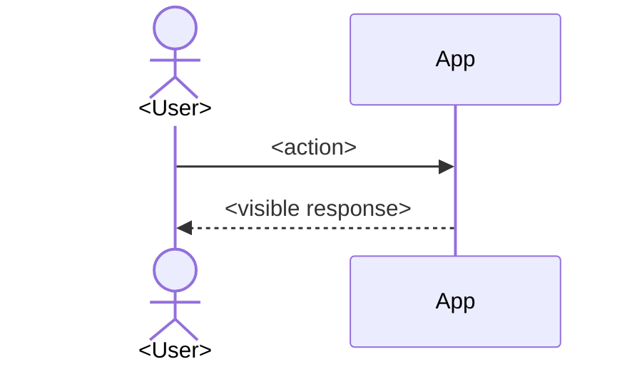

# Split a milestone into Linear issues

At Mira, **one issue = one small piece of a milestone, shipped by one person**. The reference example is `example-issue.md`, next to this file. Read it before writing: it is the expected level.

This skill uses the Linear MCP. If its tools (`save_issue`, `get_project`…) are not available, stop and point the person to the "Connect the Linear MCP" section of `README.md`. Do not try another route (API, browser).

## Fixed values

- Team: `MIRA`
- Issue template: `Task`
- Labels, one from each group per issue:
  - `Types`: `Feature` (new behavior), `Improvement` (better existing behavior), `Bug` (broken behavior)
  - `Scope`: `Frontend` (what you see), `Backend` (server, data, API)

## Steps

1. **Identify the project and the milestone.** If either is missing, ask for it. `list_milestones` on the project: if the requested milestone does not exist, show the ones that do. Don't make one up.
2. **Read the context**: `get_project` (the PRD: Requirements, Goals), the milestone description (Context, In scope, Out of scope, Watch out for), then `list_issues` filtered on the project to see what already exists. Don't recreate an existing issue.
3. **Propose a split.** Start with the list: title, Type, Scope, depends on. Each issue must ship on its own and be testable through its acceptance criteria. An issue that touches the front **and** the back is split in two: the Backend issue blocks the Frontend issue. Anything out of scope for the milestone stays out.
4. **Write each issue** following the skeleton below, then show everything. Wait for an explicit "ok". No "ok", nothing gets created.
5. **Create, in dependency order** (blockers first): `save_issue` with `team: "MIRA"`, `template: "Task"`, `title`, `description`, `project`, `milestone`, `labels: ["<Type>", "<Scope>"]` and `blockedBy` = the identifiers (MIRA-xx) of the already-created issues it depends on. The description **replaces** the template body, so it must contain every section.
6. **Reply** with the list of identifiers created and their dependencies.

## Issue skeleton

````
## TL;DR
<2-3 sentences: what the user will be able to do, what this ticket adds, what comes in the next ticket.>

## Requirements
### <Element 1>
- <precise behavior>

### <Element 2>
- <precise behavior>

## Flow


## Acceptance criteria
- [ ] <observable, checkable behavior>

## Decisions
- <what was settled, and where (milestone, discussion, PR)>
````

## Writing rules (taken from the example)

- **TL;DR** says for whom, what this ticket adds, and what it leaves to the next ticket.
- **Requirements** are grouped by element (a button, a dialog, an endpoint, a table) and describe precise behaviors, including states (disabled, empty, error, conflict with a teammate).
- **UI copy** is written word for word, in quotes.
- **Flow**: a sequence diagram when there is an exchange (user ↔ app, or service ↔ service on the Backend). Otherwise delete the whole section, heading included.
- **Acceptance criteria**: one per observable behavior, phrased so they can be ticked while testing. Include edge cases and "Cancel changes nothing".
- **Decisions**: what is settled and its source. If nothing is settled, keep the heading with an empty bullet.
- For a Backend issue, replace UI copy with the exact contracts (route, fields, error codes, table name) in backticks.
- English, short sentences, the same word for the same thing from start to finish.
