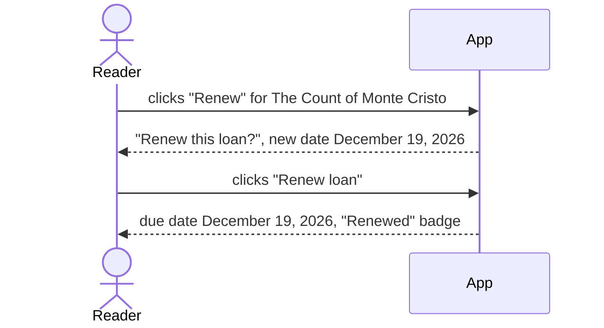

## TL;DR

A reader should be able to keep a book longer without going to the library. This ticket adds the "Renew" button on each active loan and its confirmation; the due date moves back 14 days. The email reminder before the due date comes in the next ticket.

## Requirements

### The button

- A "Renew" button to the right of the due date, on each row of "My loans"; at 375 px wide, it moves below the date.
- Disabled, with the tooltip "This book is reserved by another reader", when a reservation exists.
- Disabled, with the tooltip "Already renewed once", after a first renewal.

### The confirmation

- Title "Renew this loan?".
- Text: "The Count of Monte Cristo will be due on December 19, 2026 instead of December 5, 2026. A loan can only be renewed once.".
- "Renew loan" confirms; "Cancel" and the dialog's close button close it without changing anything.
- After confirming, the new date shows on the row, followed by the "Renewed" badge.
- An overdue loan cannot be renewed: the button is replaced by "Overdue since December 5".

## Flow

## Acceptance criteria

- [ ] "Renew" opens the confirmation, with the book title, the old date and the new date.
- [ ] After confirming, the due date moves back exactly 14 days and the "Renewed" badge appears.
- [ ] A loan already renewed has the button disabled with "Already renewed once".
- [ ] A book reserved by another reader has the button disabled with "This book is reserved by another reader".
- [ ] A reservation made while the dialog is open shows "This book was just reserved, it can no longer be renewed" and leaves the date unchanged.
- [ ] "Cancel" changes nothing.

## Decisions

- Settled in milestone M2: 14 days, a single renewal per loan, no exception for teacher accounts.
- The new date is computed by the server, including when the library is closed that day: nothing to compute on screen.
- Delivery: PR stacked on the one from the ticket that blocks it.
